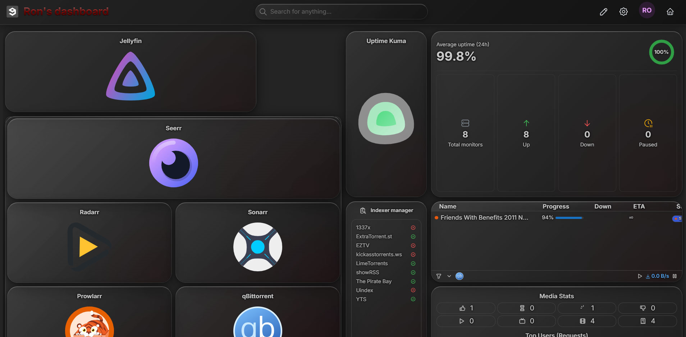

# homelab

Everything on the home server that is not the streaming system. The streaming stack
(Jellyfin, *arr, qBittorrent, ...) lives in its own repo, `streameron`, and the two repos do not
depend on each other.

Runs on the home server: a dedicated laptop with Ubuntu Server and Docker Engine, reached over
Tailscale. Until 2026-10-14 a desktop PC (Windows + Docker Desktop) served as the testing stage.
What is planned next is in [docs/ROADMAP.md](docs/ROADMAP.md).

## Screenshots

### Dashboard (Homarr)



<!-- Add more as the project grows, one heading per system:
### Monitoring (Uptime Kuma)

-->

## Layout

One folder per stack under `stacks/`. Each stack is self-contained:

```
stacks/<name>/
  compose.yaml    # the services
  .env.example    # template for secrets/settings -> copy to .env
  appdata/        # the apps' data (git-ignored, created on first run)
```

Outside `stacks/`: `dockge/` (the stack manager, kept out of `stacks/` so it never manages itself),
`docs/ROADMAP.md` (what is planned) and `docs/images/` (screenshots).

Run a stack from inside its folder:

```bash
cd stacks/<name>
docker compose up -d
```

## Stacks

`<host>` below is the server's Tailscale name or LAN IP (`localhost` when working on the server itself).

| Stack | Services | Address | Status |
|---|---|---|---|
| `dashboard` | Homarr + its Tailscale machine | http://<host>:7575, https://dashboard.<tailnet>.ts.net | in use |
| `monitoring` | Uptime Kuma, WUD (+ socket-proxy) | http://<host>:3001, http://<host>:3000 | in use |
| `tools` | IT-Tools | http://<host>:8081 | in use |
| `event-seeker` | Event Seeker (own image, from the `event-seeker` repo) | http://<host>:8765 | in use |
| `tlv-hunter` | TLV Apartment Hunter (own image) + its Tailscale machine | https://tlvapthunter.<tailnet>.ts.net | in use (2026-10-17) |
| `dockge` (in `dockge/`, not a stack) | Dockge, manages every stack above plus streameron | http://<host>:5001 | in use |

Everything not installed yet is listed in [docs/ROADMAP.md](docs/ROADMAP.md).

## Conventions

- **No shared Docker networks between stacks or with streameron.** A service that needs another
  stack's service reaches it through the host's published port:
  `http://host.docker.internal:<port>`.
- **Remote access** is through the Tailscale app on the host (`http://<host>:<port>`). A
  per-service Tailscale container is the exception, for a service that deserves its own
  easy-to-find name (the dashboard) or is shared with other people.
- **Secrets** go in each stack's `.env`, never in git.
- **One container per tool, grouped into stacks by purpose.** Tools are never merged into one
  container; a stack (one `compose.yaml`) is the unit that is started, stopped and moved.
- **Docker socket.** Access to it is effectively control of the host, so no app container mounts
  it. A tool that only needs to *read* Docker state goes through `socket-proxy` (in the
  `monitoring` stack), which exposes a filtered read-only API. A tool that must *manage*
  containers (Dockge, in `dockge/`) is a deliberate, documented exception.

## dashboard (Homarr)

### First run

1. `cd stacks/dashboard`, copy `.env.example` to `.env`, fill `SECRET_ENCRYPTION_KEY`.
2. `docker compose up -d`, open http://<host>:7575 and complete onboarding.
3. Add the streameron integrations. For each one:
   - **Integration URL** (used by Homarr itself): `http://host.docker.internal:<port>`
   - **App URL** (what the browser opens): the host's LAN IP or Tailscale name

   The two are not interchangeable: the host's name resolves in the browser but not inside the
   Homarr container (`ENOTFOUND`), and `host.docker.internal` means nothing to the browser.

| Service | Port |
|---|---|
| Jellyfin | 8096 |
| Seerr | 5055 |
| Sonarr | 8989 |
| Radarr | 7878 |
| Bazarr | 6767 |
| Prowlarr | 9696 |
| qBittorrent | 8080 |

### Backup / moving hosts

Stop the stack, copy `stacks/dashboard/appdata/` and the `.env` to the new host. The same
`SECRET_ENCRYPTION_KEY` must come along, otherwise the saved integration keys cannot be read.

`appdata/tailscale/` is the `dashboard` machine's identity (private key, treat as a secret).
Copied along, the machine keeps its name. Never run the same state on two hosts at once.

## monitoring (Uptime Kuma)

Uptime Kuma itself needs no settings (the stack's `.env` is for WUD, below).
`cd stacks/monitoring`, `docker compose up -d`, open http://<host>:3001
and create the admin user (choose the embedded SQLite database if asked).

Add one **HTTP(s)** monitor per service. A plain page check is enough for most; for the *arr
apps the `/ping` endpoint answers without login.

| Service | Monitor URL |
|---|---|
| Jellyfin | `http://host.docker.internal:8096/health` |
| Seerr | `http://host.docker.internal:5055/api/v1/status` |
| Sonarr | `http://host.docker.internal:8989/ping` |
| Radarr | `http://host.docker.internal:7878/ping` |
| Prowlarr | `http://host.docker.internal:9696/ping` |
| Bazarr | `http://host.docker.internal:6767` |
| qBittorrent | `http://host.docker.internal:8080` |
| Homarr | `http://host.docker.internal:7575` |
| Event Seeker | `http://host.docker.internal:8765/health` |
| Event Seeker sources | `http://host.docker.internal:8765/health/sources` |
| Dockge | `http://host.docker.internal:5001` |

### Showing it in Homarr

Homarr's Uptime Kuma integration reads a **status page**, not the monitors directly. In Uptime
Kuma: Status Pages -> New Status Page, slug `default`, add a group with the monitors, save. Then
in Homarr add the integration with URL `http://host.docker.internal:3001` and "No secrets".
Note that a status page is readable without login by anyone who can reach port 3001.

Known limit: Uptime Kuma runs on the same machine it watches, so it reports a single service
going down, not the whole host going down.

## monitoring (WUD)

WUD (What's Up Docker) lists every running container and whether a newer image exists for it.
It refuses to start without an administrator: copy `stacks/monitoring/.env.example` to `.env`,
set `WUD_AUTH_ADMIN_USER` and `WUD_AUTH_ADMIN_PASSWORD`, then `docker compose up -d`, open
http://<host>:3000 and log in with them. The user is kept in `appdata/wud/`.

It only watches: no triggers are configured, so it never pulls or restarts anything. Updating
stays manual, with Dockge's **Update** button (whole stack) or by hand:

```bash
cd <the stack's folder>
docker compose pull
docker compose up -d
```

It reads Docker through `socket-proxy` (same compose file), which allows listing containers and
images and refuses every write. `socket-proxy` has no published port; only this stack reaches it.

Containers on a floating tag such as `latest` are compared by image digest, so the update shows
as `sha256:...` and only means a new build was published; containers pinned to a version tag
(for example `recyclarr:8`) are compared by version number.

## event-seeker

A site that collects shows from venue sites (Barby, Reading 3, Zappa) and emails an alert when
a followed artist gets a new show. It is a separate project
([ron45700/event-seeker](https://github.com/ron45700/event-seeker)); this stack only runs its
published image, the same way the other stacks run third-party images.

### First run

1. `cd stacks/event-seeker`, copy `.env.example` to `.env`. It can stay as is: email and
   Telegram are off until their values are filled in.
2. `docker compose up -d`, open http://<host>:8765.
3. To keep the users and subscriptions from a development copy, stop the stack and put that
   copy's `data/event_seeker.db` in `appdata/event-seeker/` before starting it.

If the pull fails with `denied` / `unauthorized`, the image is still private: on GitHub open
the `event-seeker` package (profile -> Packages) -> Package settings -> Change visibility ->
Public. A package is created private on its first publish, whatever the repo's visibility.

### Updating

The image is rebuilt by a GitHub Action on every push to the `event-seeker` repo's `main`
(after its tests pass). WUD shows the new build as a digest change on `latest`. Then:

```bash
cd stacks/event-seeker
docker compose pull
docker compose up -d
```

In Dockge this is the stack's **Update** button. To go back to an older build,
set the image tag to that commit's `sha-<short sha>` tag instead of `latest`.

### On the dashboard and in Uptime Kuma

- **Homarr:** Manage -> Apps -> New app. Name `Event Seeker`, URL = the host's LAN IP or
  Tailscale name with port 8765 (what the browser opens), then add the app to the board. For
  the up/down dot on the tile, set the ping URL to `http://host.docker.internal:8765/health`.
- **Uptime Kuma:** two HTTP(s) monitors (in the table above), then add both to the status page
  group so they show in Homarr.
  - `/health` answers 200 while the site itself is up.
  - `/health/sources` answers 503 when a venue site has failed 3 hourly runs in a row or the
    hourly run stopped, so the monitor goes red when shows stop coming in. A check every
    10-15 minutes is enough; the data changes once an hour. For one monitor per venue use
    `/health/sources/barby`, `/reading3`, `/zappa`.

### Telegram alerts

Event Seeker sends its own Telegram message when a source breaks and when it recovers, without
depending on Uptime Kuma. Create a bot with @BotFather, fill `TELEGRAM_BOT_TOKEN` and
`TELEGRAM_CHAT_ID` in `.env`, `docker compose up -d`, and check it with:

```bash
docker compose exec event-seeker python -m app.main test-alert
```

Uptime Kuma can use the same bot and chat id for its own notifications (see the roadmap).

## tlv-hunter

Rental posts from public Tel Aviv apartment Facebook groups, classified once by a language model,
on a site with per-user filters. A separate project
([ron45700/TAH-tlv_apartment_hunter](https://github.com/ron45700/TAH-tlv_apartment_hunter)); its
plan for this stack is that repo's `docs/DEPLOY.md`. This stack only runs its published image
(`ghcr.io/ron45700/tah-tlv_apartment_hunter`), with its own Tailscale machine, `tlvapthunter`,
like the dashboard's.

**The store is `appdata/store/`** (SQLite, the photos, the dated backups). The photos cannot be
fetched again, so: **never `docker compose down -v`, never Dockge's Delete**, and `appdata/store/`
is never copied by hand while the site runs (use `export_backup --no-photos`, below).

The job commands run one at a time, from this folder (never two at once):

```bash
docker compose run --rm jobs python -m tlv_hunter.jobs.<command> ...
```

Every command that calls Apify or OpenAI is **paid**; each run needs my explicit go.

### First run (a fresh store)

1. `cd stacks/tlv-hunter`; copy `.env.example` to `.env` (a new auth key: not reusable, not
   ephemeral, no tags) and `jobs.env.example` to `jobs.env` (the two keys); `chmod 600 .env jobs.env`.
2. Create the data folders **before** the first start (Docker would create them as root, and the
   image runs as uid 10001):

   ```bash
   mkdir -p appdata/store appdata/labeling appdata/gate_d appdata/store_exports appdata/tailscale
   sudo chown -R 10001:10001 appdata/store appdata/labeling appdata/gate_d appdata/store_exports
   ```

3. `docker compose pull`, then check the SQLite in the image (3.46.1 expected):
   `docker compose run --rm jobs python -c "import sqlite3; print(sqlite3.sqlite_version)"`.
4. **PAID, on my go:** the first collection run creates the store, 30 posts per group:
   `docker compose run --rm jobs python -m tlv_hunter.jobs.run_once --bootstrap --max-posts 30`.
   Never `--bootstrap` again.
5. **PAID, on my go:** `docker compose run --rm jobs python -m tlv_hunter.jobs.classify_pending --cap 0.10`.
6. The admin, once (asks the username and the password twice, hidden):
   `docker compose run --rm jobs python -m tlv_hunter.jobs.create_admin`.
7. `docker compose up -d site tailscale-tlvapthunter`. On the Machines page, `tlvapthunter` ->
   `...` -> **Disable Key Expiry**; then clear `TS_AUTHKEY` in `.env`.
8. A real sign-in through `https://tlvapthunter.<tailnet>.ts.net` (done 2026-10-17: a sign-in is a
   write checked against `Host`/`Origin`, so it is the probe), before anyone else is let in.

Port 8000 is published on the server's `127.0.0.1` only; the tailnet reaches the site only through
`tlvapthunter` (443).

### Updating

The image is rebuilt by the repo's GitHub Action on every push to its `main`; WUD shows the new
build as a digest change on `latest`. **Before each update, a fresh backup** (never while
`measure_day.sh` runs):

```bash
cd stacks/tlv-hunter
docker compose run --rm jobs python -m tlv_hunter.jobs.export_backup --no-photos
docker compose pull
docker compose up -d
```

In Dockge this is the stack's **Update** button, after the `export_backup`. To go back to an
older build, set the image tag of `site` and `jobs` to that commit's `sha-<short sha>` tag.

### Backups (restic)

`export_backup --no-photos` writes a checked, dated copy of the database into
`appdata/store_exports/` (the photos are not exported on this server). Every command that writes a
dated backup keeps the **7 newest** and deletes the older ones, in `appdata/store/` and in
`appdata/store_exports/`; nothing else is ever deleted.

For restic:

- **include** `stacks/tlv-hunter/appdata/store_exports/*.sqlite3` (the database copies) and
  `stacks/tlv-hunter/appdata/tailscale/` (the `tlvapthunter` machine's identity, a secret);
- **exclude** `stacks/tlv-hunter/appdata/store/` (the live store: a copy taken while the site writes
  may be torn) and every `images/` folder (the photos: not backed up).

### The measured day (`measure_day.sh`)

One day of collection and classification, measured: for 24 hours from its start, a slot every 30
minutes (at :00 and :30, none between 00:00 and 07:00 Israel time), each running `run_once` and
then `classify_pending --cap 0.05`, one after the other. **Every slot is paid** (Apify and OpenAI),
so it is started only on my go, and **no other job command runs while it does** (not even
`export_backup`). Everything goes to `appdata/measure/<the start date>.log`.

From this folder (`cd ~/homelab/stacks/tlv-hunter`):

| To | Type |
|---|---|
| start it (it keeps running after the SSH window closes) | `bash measure_day.sh start` |
| check that it runs, and what it did last | `bash measure_day.sh status` |
| see the log's last lines | `bash measure_day.sh log` (or `bash measure_day.sh log 100`) |
| follow the log live (Ctrl+C stops the watching, not the day) | `tail -f appdata/measure/*.log` |
| stop early | `bash measure_day.sh stop` |
| the totals, at the end of the day | `bash measure_day.sh totals` |

**Stopping early** lets the command running at that moment finish (a collection run is never cut in
the middle), then stops; if that was `run_once`, its new posts wait for the next
`classify_pending`. `status` says "not running" once it has stopped. It also stops by itself after
24 hours, or after 3 failed collection runs in a row (a failed run is logged and the next slot
covers its window). **The totals** count the slots, the collection runs, the rows and the posts
stored, Apify's cost as each run reported it, and the classification calls, tokens and cost; the
real figures are the two bills (Apify's console, OpenAI's usage page).

### A forgotten admin password

With the site stopped: `docker compose stop site`, then
`docker compose run --rm jobs python -m tlv_hunter.jobs.reset_admin_password`, then
`docker compose up -d site`.

### Moving hosts

Stop the stack, copy `appdata/`, `.env` and `jobs.env` to the new host. `appdata/tailscale/` is
the `tlvapthunter` machine's identity (a secret); never run the same state on two hosts at once.

## dockge

A web UI over `docker compose`: start, stop, restart and update each stack, and see its logs. It
runs normal compose commands in each stack's folder, so the command line keeps working as before.

### First run

1. `cd dockge`, copy `.env.example` to `.env` and set the two **absolute** paths:
   `STACKS_DIR` (this repo's `stacks/`) and `STREAMERON_DIR` (the streameron clone).
2. Link streameron into the stacks folder and keep the link out of git (local-only ignore):

   ```bash
   ln -s "$HOME/streameron" "$HOME/homelab/stacks/streameron"
   echo 'stacks/streameron' >> ~/homelab/.git/info/exclude
   ```

3. `docker compose config --quiet`, then `docker compose up -d`, open http://<host>:5001 and
   create the admin user. All stacks, streameron included, show as **active**.

The stacks path is mounted with the same absolute path inside and outside the container (Dockge
requirement), which is why it comes from `.env` and not a relative path.

### Rules

- **Full Docker socket**: whoever controls Dockge controls the host. Port 5001 is for me only, never
  shared over Tailscale; strong admin password; the web console stays off (default since 1.5.0).
- **Update** works per stack (pulls every image, recreates only containers whose image changed). One
  service only: `docker compose pull <service> && docker compose up -d <service>` in its folder.
  Back up `appdata/` before updating.
- **Never press Delete** on a stack: it deletes the stack's folder.
- **Edit compose files in git**, not in Dockge's editor (saving there writes the real file).

## tools (IT-Tools)

`cd stacks/tools`, `docker compose up -d`, open http://<host>:8081. Static web app, no data.
